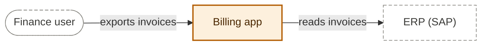
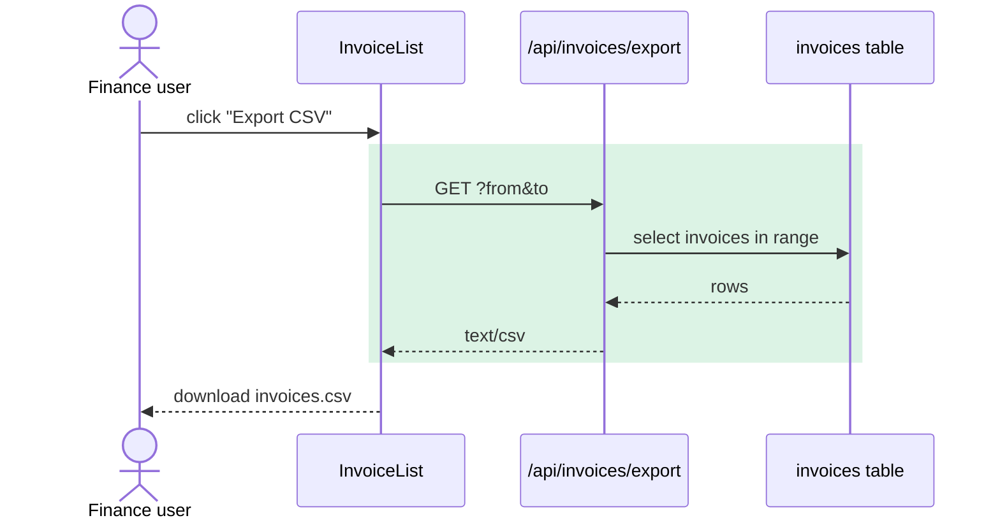
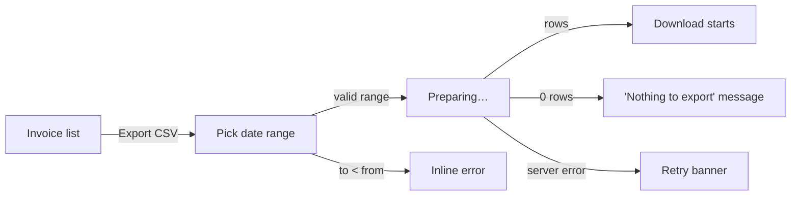

# Factory visuals

Pictures a human approves at a glance, so the text becomes reference, not the
thing they must read. The `visualizer` agent draws them; the dashboard's Visual
view and PR descriptions show them. Every diagram is **Mermaid** text (diffable,
rendered by GitHub and the dashboard); wireframes are small static HTML files.

## Folder

```
factory/jobs/<job-id>/visuals/
  index.md                  manifest: one line per visual, what to check (always)
  context.mmd               plan: who and what is involved
  solution.mmd              plan: the parts this job adds or changes
  interaction.mmd           plan: the main story as a sequence
  logical.mmd               plan: data model / domain objects
  deployment.mmd            plan: where it runs (only when infra changes)
  ux-journey.mmd            plan: screens and states a user moves through
  ui-<screen>.html          plan: low-fidelity wireframe per new/changed screen
  chat.md                   plan: the same pictures as text, for the conversation (always)
  as-built/                 after review passes: the same names, redrawn from the code
    solution.mmd, interaction.mmd, ... drift.md and chat.md
```

Screenshots of the running app live with the reviews that took them:
`round-<N>/screens/ux-<state>.png` and `round-<N>/screens/ui-<screen>-{desktop,phone}.png`.

## Which visuals, when

Config `## Visuals` sets each to `always`, `auto` or `off`. `auto` means: draw it
only when the job has something to show.

| File | Draw when (`auto`) | Mermaid type |
| --- | --- | --- |
| `context.mmd` | always useful | `flowchart LR` |
| `solution.mmd` | always useful | `flowchart TB` |
| `interaction.mmd` | a story involves 2+ parts talking (user→UI→API→DB, CLI→lib) | `sequenceDiagram` |
| `logical.mmd` | entities, tables, schemas, types or domain objects are added or changed | `erDiagram` (data) or `classDiagram` (code types) |
| `deployment.mmd` | hosting, containers, infra, CI/CD, env config or external services change | `flowchart LR` |
| `ux-journey.mmd` | a user-facing flow (pages, CLI dialogue, messages) is added or changed | `flowchart LR` (or `stateDiagram-v2`) |
| `ui-<screen>.html` | a page or screen is added or visibly changed | HTML |

The ticket dependency graph and the review verdicts are drawn by the dashboard
itself from `tickets/` and `job.json`; never draw those.

## One legend for every diagram

Status is shown the same way everywhere, so a reader learns it once:

```
classDef new      fill:#dcf3e5,stroke:#1f8a4c,color:#0d3d22,stroke-width:2px
classDef changed  fill:#fdf0dd,stroke:#b45f06,color:#4a2700,stroke-width:2px
classDef existing fill:#f0efeb,stroke:#8a8983,color:#3a3a37
classDef external fill:#ffffff,stroke:#8a8983,color:#3a3a37,stroke-dasharray:5 3
classDef risk     fill:#fbe6ee,stroke:#b4235a,color:#5a0f2b,stroke-width:2px
```

- **new** (green): added by this job. **changed** (amber): modified by this job.
- **existing** (grey): untouched, shown only for orientation. **external** (dashed):
  outside this repo (third-party APIs, other systems, people's tools).
- **risk** (pink): anything the merge policy or COMPLIANCE.md cares about (PHI
  store, auth boundary, payment call, migration). Use sparingly; it is the
  reviewer's eye-catcher.
- Paste the `classDef` block at the end of every `flowchart`. In `sequenceDiagram`
  use `rect rgb(220,243,229)` blocks to shade the new steps, and
  `Note over X: PHI` for risk.

## Rules that keep diagrams worth looking at

- **Small.** 5–12 nodes. If it needs more, it is two diagrams or the wrong level.
- **Real names.** Nodes are real modules, files, services, tables, screens, using
  `GLOSSARY.md` terms. Label edges with the verb or payload (`POST /export`,
  `reads claims`), never bare arrows.
- **Show the change, not the system.** Existing parts appear only where the new
  parts attach to them.
- **Trace to the spec.** Where a node or step delivers a user story, add it to the
  label: `CSV export button<br/>S1, S3`.
- **Plain Mermaid only.** No C4 or beta syntaxes, no `click`, no HTML other than
  `<br/>`. Quote labels containing punctuation: `A["Export (CSV)"]`. Node ids are
  simple words (`exportApi`), never reserved words (`end`, `graph`, `style`).
- **First line of every `.mmd` is a comment** saying what it shows:
  `%% Solution: where CSV export attaches to the invoice list`.

## Starting points







## Wireframes (`ui-<screen>.html`)

Low fidelity on purpose: the question is *what is on the screen and where*, not
colours. One self-contained file per screen, no external assets or scripts.

- Greyscale boxes, system font, real labels and copy from the spec. Mark new or
  changed regions with a 2px green (new) or amber (changed) outline and a small
  corner tag `S1` linking the story.
- Show the states that matter side by side on one page (e.g. *empty*, *loaded*,
  *error*), each in a titled frame about 360px wide (phone) or 960px (desktop),
  matching the device the spec targets.
- Put a 2–4 line note at the top: screen name, purpose, what to check.
- Never copy a real brand's look; reuse the repo's own layout structure only.

## Pictures in the conversation (`chat.md`)

The human decides in the chat, so the pictures must be in the chat too, not only
on the dashboard. Mermaid does not render in a terminal, so the visualizer also
writes a text version, `visuals/chat.md` (plan) or `visuals/as-built/chat.md`
(as-built), and the orchestrator pastes it at every decision point. The `.mmd`
files stay the source of truth: `chat.md` never shows anything they don't.

- **First line**, the legend:
  `Legend: [+] new  [~] changed  [!] risk  (name) external  unmarked = existing`
- **One block per picture worth deciding on**, in this order: context, solution,
  then interaction, then ux-journey if it still fits; at most four. Each block: a bold
  heading line, the drawing in a ` ```text ` fence, then `Check: <the question from index.md>`.
- **Every line** of `chat.md` fits in 76 columns, prose lines included (wrap
  them), so it survives a narrow terminal.
- **Drawing:** at most 18 lines, spaces only (no tabs), box
  characters `┌ ─ ┐ │ └ ┘` and arrows `▶ ◀ ▼ ▲`. Same names as the `.mmd`
  (shortened is fine) and the same story tags. Status goes in the label with the
  legend marks. Label every edge with its verb.
- **Sequences** become numbered steps, one message per line, new steps marked
  `[+]`: `2 main → bmi        bmi(70, 175) = 22.9`.
- **Wireframes** become a text sketch per screen (at most 12 lines): regions in
  boxes, real copy from the spec.
- **As-built `chat.md`:** the solution as built, then `Drift:` with one line per
  `drift.md` line, `UNEXPLAINED` ones first and keeping that word, then any known
  gap the build files name.
- At most 70 lines in all. If a picture can't be drawn legibly in that space,
  draw its most important part and say `(full picture: dashboard)`.

Example (plan, from `examples/001-bmi-category-cli/visuals/chat.md`):

````markdown
Legend: [+] new  [~] changed  [!] risk  (name) external  unmarked = existing

**Context: who uses it and what it touches**
```text
 (Library user)  S1 S2              (Command-line user)  S3 S4 S5
       │ from vitals import                │ python -m vitals bmi
       ▼                                   ▼
 ┌───────────────────────────────────────────────────┐
 │ [~] vitals package: bmi_category + bmi command    │
 └───────────────────────────────────────────────────┘
       │ implements thresholds from
       ▼
 (WHO TRS 894 cut-offs, cited in code)
```
Check: Is anyone or anything missing?
````

## Showing visuals at a decision point

Whenever you ask the user to decide (the spec gate, **Needs human**, a
characterize verdict, `/factory show`):

1. **Paste** the job's `chat.md` into your reply verbatim, without summarising
   it: `visuals/chat.md` at the spec gate; `visuals/as-built/chat.md` (else the
   plan's) when a built job waits for sign-off. If the file is missing, draw the
   context and solution yourself from the `.mmd` files by the rules above.
2. **Open** the full-size view: run `./factory/show.sh <job-id>`. It starts the
   dashboard if needed and opens it at this job's Visual view. If it fails or
   there is no browser (a remote session), add one line:
   `Full-size view: ./factory/show.sh <job-id>` and carry on. Skip this step for
   characterize jobs: they have no `visuals/`.
3. **Then** the short text summary and the question, ending with the exact
   replies that work (`approve`, or what to change).

A comment on a picture is a comment on the spec or the build: map it to the
story, criterion or file it points at.

## index.md

```markdown
# Visuals: <job title>
Mode: plan | as-built

| Visual | Shows | Check |
| --- | --- | --- |
| context.mmd | finance user, billing app, ERP | Is anyone or anything missing? |
| solution.mmd | new export endpoint + button on the existing list | Is this the part you expected to change? |
| ui-invoice-list.html | button placement; empty and error states | Copy and placement OK? |

Skipped: deployment (no infra change), logical (no data model change).
```

## as-built/drift.md

After review passes, the visualizer redraws the same set from the actual diff
and lists every difference from the plan:

```markdown
# Drift: plan vs as-built
- solution: + `csvWriter` helper — explained: review round 1 code #2 (build/fix-round-1.md)
- interaction: date validation moved from UI to API — UNEXPLAINED
- none in: context, logical
```

One line per difference. End each with `— explained: <cause and file>` or
`— UNEXPLAINED` (that exact uppercase word: the dashboard highlights it and the
approver searches for it). Never write the word for drift that is explained.
The approver reads drift.md: explained drift is fine; `UNEXPLAINED` drift on a
**risk** node is a reason to escalate.
